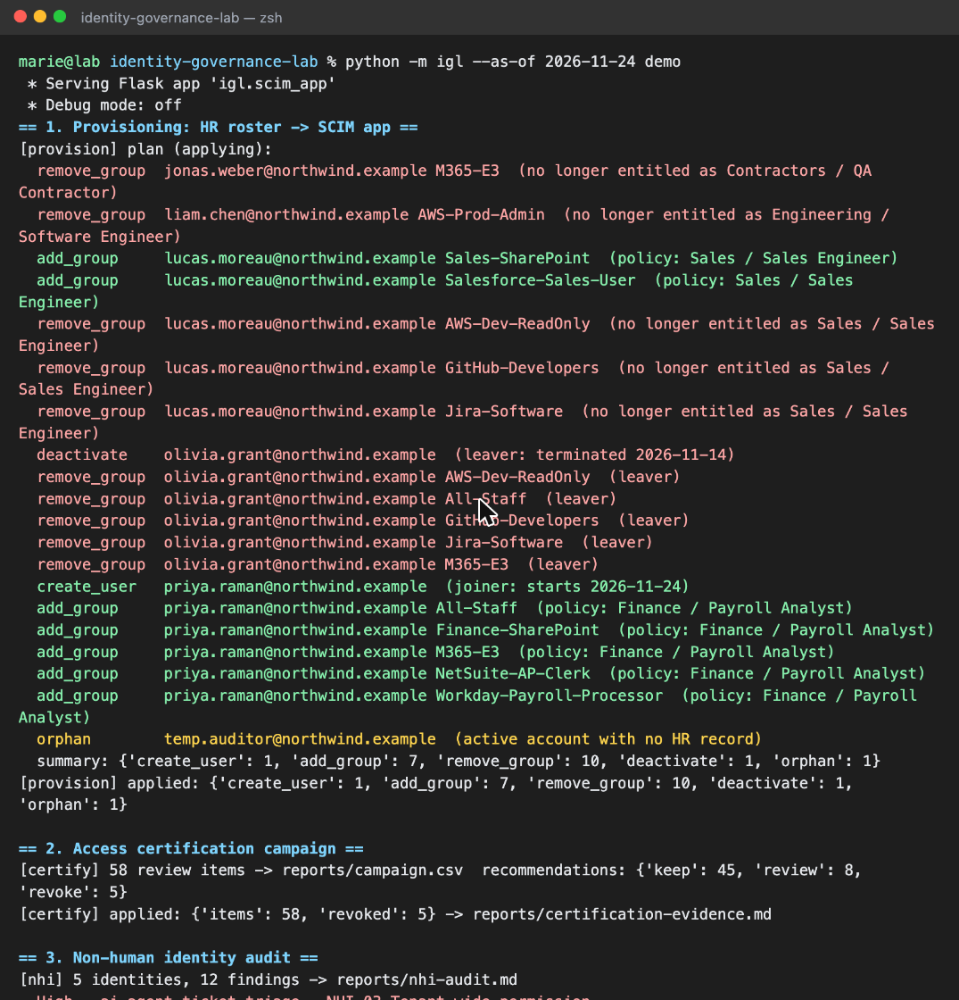
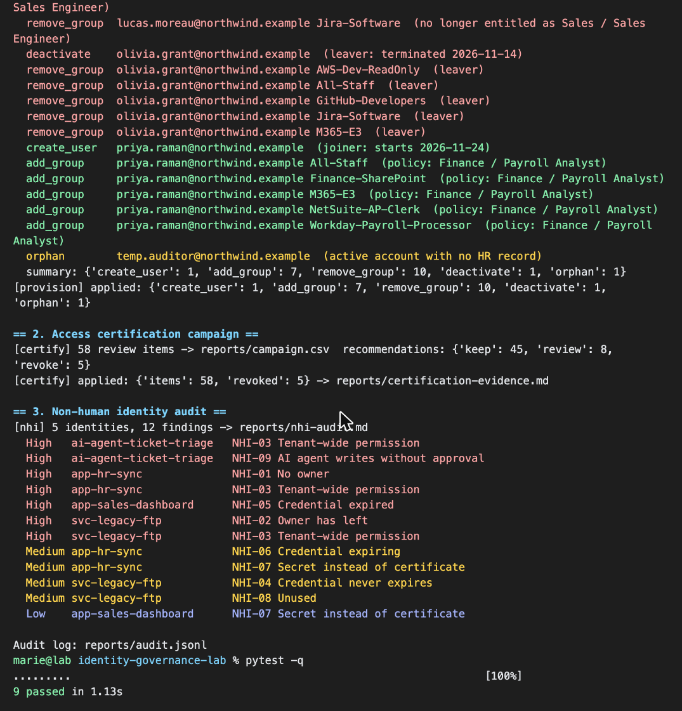
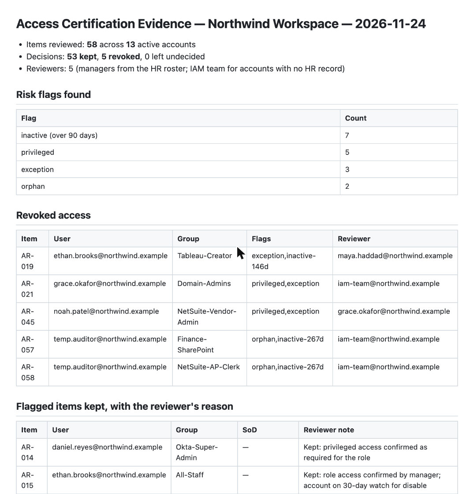
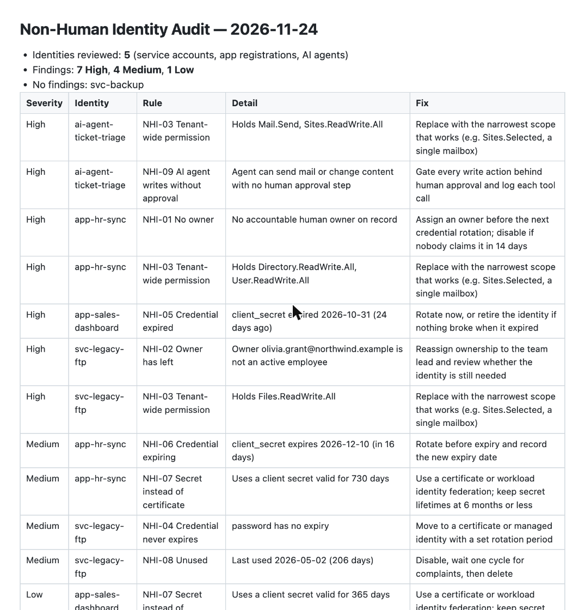

# Identity Governance Lab: SCIM Provisioning, Access Certification and Non-Human Identity Audit

An identity governance and administration (IGA) program for a fictional 13-person company, Northwind, built and run end to end in Python. It covers the work an IAM analyst or junior identity engineer does every week:

- **Joiner, mover, leaver provisioning** from an HR roster into an app over **SCIM 2.0**, the protocol Okta, Microsoft Entra ID and SailPoint use to provision SaaS apps
- **Access certification campaigns** (user access reviews): manager-assigned reviewers, risk flags, revocation through SCIM and an evidence report for audit
- **Separation-of-duties (SoD) rules**, including the difference between a designed, mitigated conflict and an exception
- **A non-human identity audit** of service accounts, app registrations and an AI agent

It runs on a laptop with no cloud accounts: `python -m igl demo`. The included [reports/](reports/) are the output of a real run.

**Author:** Marie Haccandy, M.S. Cybersecurity Management · [LinkedIn](https://www.linkedin.com/in/marie-christine-haccandy-24b6b21ba) · [GitHub](https://github.com/mhacc001)

```
 HR roster (source of truth)        access policy (birthright, department + title roles,
 data/hr_roster.csv                 privileged groups, SoD rules)  data/access_policy.json
            │                                   │
            └──────────────┬────────────────────┘
                           ▼
              1. provisioning engine ── plan, then apply ──►  SCIM 2.0 app (Flask)
                 joiner / mover / leaver                        /scim/v2/Users, /Groups
                           │                                         │
              2. certification campaign ◄── snapshot of who has what ┘
                 reviewers decide keep / revoke ── revocations over SCIM
                           │
              3. non-human identity audit   data/nhi_inventory.json
                           │
                           ▼
        reports/: campaign CSV, evidence report, NHI findings, before/after state, audit.jsonl
```

## Screenshots

| | |
|---|---|
|  **Provisioning run.** The joiner, mover and leaver changes, plus the orphan account. |  **Campaign, NHI audit and tests.** 5 revoked, 12 NHI findings, 9 tests passing. |
|  **Certification evidence.** Revoked items and reviewer reasons. |  **Non-human identity audit.** Findings with fixes. |

## The starting point: a tenant with real-world drift

The target app ([data/app_seed.json](data/app_seed.json)) starts with the problems access reviews keep finding:

| Problem | Who |
|---|---|
| Leaver still active 10 days after termination | Olivia (terminated 2026-11-14) |
| Mover kept old access | Lucas moved Engineering → Sales but still has GitHub and AWS |
| Joiner not provisioned yet | Priya, Payroll Analyst starting 2026-11-24 |
| Privileged access outside the role | Liam (developer) holds AWS-Prod-Admin |
| Manual privileged grants | Grace holds Domain-Admins; Noah holds NetSuite-Vendor-Admin |
| SoD conflict | Noah can both create vendors and approve payments |
| Orphan account | temp.auditor has no HR record and has not signed in for 267 days |
| Contractor with a staff license | Jonas (contractor) holds M365-E3 |
| Inactive user with extra access | Ethan has not signed in for 146 days and holds Tableau-Creator |

## 1. Provisioning: joiner, mover, leaver over SCIM

[igl/provisioning.py](igl/provisioning.py) computes desired access as **birthright + department role + title role** for every active person in HR. It then plans the changes and applies them through SCIM calls ([igl/scim_client.py](igl/scim_client.py)). Real output:

```
create_user   priya.raman@northwind.example  (joiner: starts 2026-11-24)
add_group     priya.raman@northwind.example Workday-Payroll-Processor  (policy: Finance / Payroll Analyst)
add_group     lucas.moreau@northwind.example Salesforce-Sales-User  (policy: Sales / Sales Engineer)
remove_group  lucas.moreau@northwind.example GitHub-Developers  (no longer entitled as Sales / Sales Engineer)
deactivate    olivia.grant@northwind.example  (leaver: terminated 2026-11-14)
remove_group  liam.chen@northwind.example AWS-Prod-Admin  (no longer entitled as Engineering / Software Engineer)
remove_group  jonas.weber@northwind.example M365-E3  (no longer entitled as Contractors / QA Contractor)
orphan        temp.auditor@northwind.example  (active account with no HR record)
summary: {'create_user': 1, 'add_group': 7, 'remove_group': 10, 'deactivate': 1, 'orphan': 1}
```

Design choices:

- **Provisioning owns only policy groups.** Groups the policy never grants (Domain-Admins, NetSuite-Vendor-Admin, Tableau-Creator) are exceptions. Provisioning does not silently remove them. The access review decides, so every exception gets a named reviewer and a recorded reason.
- **Orphans are reported, never auto-deleted.** Deleting an account nobody can explain needs a human decision.
- **Plan before apply.** `--dry-run` prints the plan and changes nothing. A second run after apply has nothing left to do (tested).
- **Leavers are disabled, not deleted**, so the account stays available for audit.

The SCIM app ([igl/scim_app.py](igl/scim_app.py)) implements the RFC 7644 calls an IdP connector makes: bearer-token auth, `userName eq` filters, `POST /Users`, `PATCH active`, and group `PATCH add/remove members`.

## 2. Access certification campaign

[igl/certification.py](igl/certification.py) snapshots every active account and turns each entitlement into a review item ([reports/campaign.csv](reports/campaign.csv)):

- **Reviewer** = the user's manager from HR. Accounts with no HR record, and the top of the org chart, go to the IAM team.
- **Flags:** `privileged`, `exception` (not granted by policy), `orphan`, `inactive-<n>d` (over 90 days), and SoD rule hits.
- **Recommendation:** `revoke` for orphans and for exceptions that are privileged, conflicting or idle. `review` for anything privileged, conflicting or inactive. `keep` otherwise.

Result: **58 items across 13 accounts, 5 revoked, 53 kept, 0 left undecided.** The tool refuses to apply a campaign with blank decisions. From [reports/certification-evidence.md](reports/certification-evidence.md):

| Item | User | Group | Flags | Outcome |
|---|---|---|---|---|
| AR-045 | noah.patel | NetSuite-Vendor-Admin | privileged, exception | Revoked. This also resolves SOD-01 on AR-043. |
| AR-021 | grace.okafor | Domain-Admins | privileged, exception | Revoked |
| AR-019 | ethan.brooks | Tableau-Creator | exception, inactive 146 days | Revoked. The account goes on a 30-day watch. |
| AR-057/058 | temp.auditor | Finance-SharePoint, NetSuite-AP-Clerk | orphan, inactive 267 days | Revoked and account disabled |
| AR-052 | sofia.martins | AWS-Prod-Admin | privileged, SOD-03 (mitigated) | Kept: designed SRE combination with a mitigating control |

### Separation of duties

Three rules live in [data/access_policy.json](data/access_policy.json): vendor creation vs payment approval, payroll processing vs payroll administration, and code vs production admin. A conflict counts as **mitigated only if the policy itself grants both sides and the rule names a mitigating control**. That is why Sofia (SRE) is kept, while the same combination on a developer would be flagged for revocation.

## 3. Non-human identity audit

Service accounts, app registrations and AI agents need owners, rotation and least privilege too. [igl/nhi.py](igl/nhi.py) checks 9 rules against [data/nhi_inventory.json](data/nhi_inventory.json). Result: **5 identities, 7 High, 4 Medium, 1 Low** ([reports/nhi-audit.md](reports/nhi-audit.md)):

| Severity | Identity | Finding |
|---|---|---|
| High | app-hr-sync | No owner, holds Directory.ReadWrite.All, and the secret expires in 16 days |
| High | svc-legacy-ftp | Owner has left the company, password never expires, unused for 206 days |
| High | app-sales-dashboard | Client secret expired 24 days ago |
| High | ai-agent-ticket-triage | Can send mail and edit sites with no human approval step |
| — | svc-backup | Clean: owned, certificate-based, read-only scope |

## Audit trail

Every provisioning change and review decision is a line in [reports/audit.jsonl](reports/audit.jsonl) with a timestamp, the user, the group and the reason or reviewer. The before and after state of the app is saved at each stage: [state-0-before.json](reports/state-0-before.json), [state-1-after-provisioning.json](reports/state-1-after-provisioning.json), [state-2-after-certification.json](reports/state-2-after-certification.json).

## Run it

```bash
python3 -m venv .venv && source .venv/bin/activate
pip install -r requirements.txt

python -m igl --as-of 2026-11-24 demo        # everything, writes reports/
pytest -q                                    # 9 tests

# step by step against a running SCIM app
python -m igl serve                          # terminal 1
python -m igl --url http://127.0.0.1:5070 provision --dry-run
python -m igl --url http://127.0.0.1:5070 provision
python -m igl --url http://127.0.0.1:5070 certify start
#   fill the decision column in reports/campaign.csv with keep / revoke
python -m igl --url http://127.0.0.1:5070 --as-of 2026-11-24 certify apply reports/campaign.csv
python -m igl --as-of 2026-11-24 nhi
```

## Layout

```
igl/scim_app.py        SCIM 2.0 service provider (Flask)
igl/scim_client.py     SCIM client used by provisioning and certification
igl/policy.py          HR roster, entitlement rules, SoD evaluation
igl/provisioning.py    joiner / mover / leaver plan and apply
igl/certification.py   review campaign, decisions, revocation, evidence report
igl/nhi.py             non-human identity rules and report
igl/audit.py           JSON Lines audit log
data/                  HR roster, access policy, seeded app state, NHI inventory
reports/               output of a real run
tests/                 pytest suite, in-process SCIM (no network)
```

## Related work

- [it-jml-toolkit](https://github.com/mhacc001/it-jml-toolkit): the joiner-mover-leaver lifecycle against Microsoft Entra ID through Microsoft Graph (PowerShell)
- [iam-lab-okta](https://github.com/mhacc001/iam-lab-okta): attribute-driven RBAC, MFA policy and JML automation in Okta, built with Terraform

All people, companies and data here are fictional.
